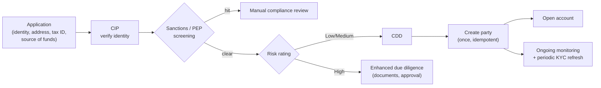
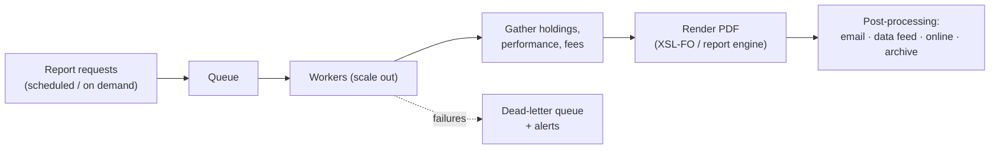

# 00 · Banking Domain: Onboarding, AML/KYC and Wealth Reporting

Run: `dotnet run` (a simplified onboarding pipeline with screening, risk rating, idempotency and an audit trail).

## Customer onboarding (KYC) flow

## Wealth-management report generation (high volume)

## Basic
- **KYC** = know who the customer is (identity, risk profile). **AML** = the wider program: KYC + transaction monitoring + sanctions screening + suspicious-activity reporting.
- A **party** is any person or organization with a relationship to the bank; accounts link to parties through roles.

## Intermediate
- **Idempotency**: clients retry after timeouts. The demo fires 5 parallel retries of the same application and still creates **one** party (`ConcurrentDictionary` + `Lazy<T>`; in production a unique key in the database).
- **Audit trail**: every decision is logged with time and reason, which regulators expect.

## Advanced
- High-volume pipelines: queue-based workers, idempotent and restartable steps, dead-letter queues, reconciliation jobs, daily health reports.
- Data protection: encrypt PII in transit and at rest, mask it in logs and lower environments, RBAC, secrets in Key Vault, approvals in CI/CD (SOX-style controls).
