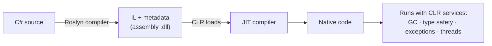
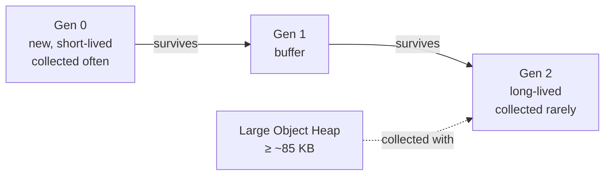

# 01 · .NET Fundamentals

Run it: `dotnet run` (prints each concept with real numbers from your machine).

## Basic
- **CLR** loads assemblies, JIT-compiles IL to native code and manages memory with the **garbage collector**.
- **Value types** (`struct`, `int`) are copied on assignment; **reference types** (`class`, `string`) share one object. The demo shows both.
- **Strings are immutable**: `+=` creates a new string (use `StringBuilder` in loops).

## Intermediate
- **Boxing** puts a value type in a heap object. The demo boxes 5 million ints and shows the allocated megabytes; the unboxed loop allocates zero bytes.
- **GC generations**: new objects start in Gen 0; survivors move to Gen 1 and Gen 2. Objects of about 85 KB+ go to the **Large Object Heap** (reported as Gen 2).

## Advanced
- `IDisposable` + `using` release unmanaged resources **deterministically**; the GC only frees memory.
- Diagnose memory/threads in production with `dotnet-counters`, `dotnet-gcdump` and `dotnet-trace`.
- .NET Framework (Windows-only, maintenance) vs modern .NET 8/10 (cross-platform, faster, containers): new work targets .NET 8/10 LTS.
