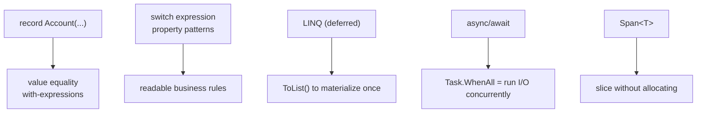

# 02 · C# Language (C# 12+; see 19 for C# 13–15)

Run it: `dotnet run`

## Basic
- `record` gives value equality, `ToString()` and `with` copies for immutable data models.
- Nullable reference types (`string?`) catch null bugs at compile time.

## Intermediate
- **Pattern matching** turns nested `if/else` into readable rules (see `Classify`).
- **LINQ deferred execution**: the demo shows a query running twice when enumerated twice.
- `IEnumerable` filters in memory; `IQueryable` (EF Core) translates to SQL.

## Advanced
- **Concurrency**: three 300 ms calls take ~900 ms sequentially and ~300 ms with `Task.WhenAll`.
- **`Span<T>`** slices strings/arrays without allocations, useful in high-volume parsing (e.g., report feeds). It is stack-only, so it cannot be a local in an `async` method — keep span code in a synchronous helper (see `ParseFeedLine`).
- Never block on async code (`.Result`, `.Wait()`): it causes thread-pool starvation under load.
