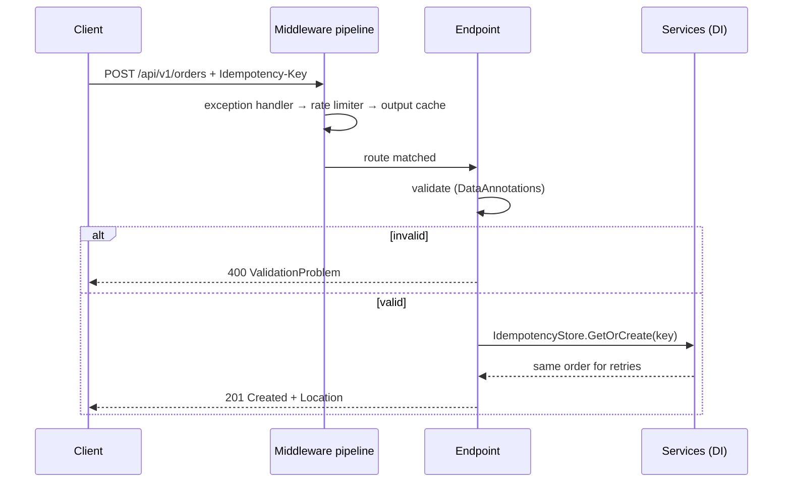

# 03 · REST API with ASP.NET Core 8 (minimal APIs)

Run: `dotnet run` → http://localhost:5080, then use [`requests.http`](requests.http) (VS / VS Code REST Client).

| Feature | Where | Built-in API |
|--------|-------|--------------|
| Validation → 400 | `Validate()` | `Validator`, `TypedResults.ValidationProblem` |
| Errors → ProblemDetails (no stack traces) | `GlobalExceptionHandler` | `IExceptionHandler`, `AddProblemDetails` |
| Rate limiting → 429 | `AddRateLimiter` | fixed window per policy |
| Output caching | `CacheOutput` | `AddOutputCache` |
| Health checks for K8s/OpenShift probes | `/health/live`, `/health/ready` | `AddHealthChecks` |
| Idempotent POST (safe client retries) | `IdempotencyStore` | `ConcurrentDictionary` + `Lazy<Task>` |
| Versioning & paging | `/api/v1/...?page=&pageSize=` | route groups |

## Basic
- Resources + HTTP verbs + status codes: 200, 201 (+Location), 204, 400, 404, 429, 500.
- GET, PUT, DELETE are idempotent; **POST is not**, so payments/onboarding need an **Idempotency-Key**.

## Intermediate
- Typed results (`Results<Ok<Order>, NotFound>`) document the possible responses in the signature.
- Middleware order matters: exception handler first, then rate limiting/caching, then endpoints.

## Advanced
- Security in production: HTTPS, JWT bearer (`Microsoft.AspNetCore.Authentication.JwtBearer`) validating issuer/audience/expiry, policy-based authorization, resource-ownership checks (prevent BOLA), and an API gateway (APIM, see [14](../14-api-management)).
- Long-running work: return **202 Accepted** with a status URL instead of blocking.
- With several API instances, rate-limit counters and idempotency keys move to Redis or the gateway.
