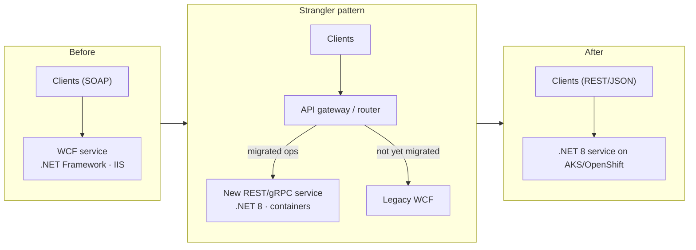

# 04 · WCF Services and Modernization

- [`legacy/IReportService.cs`](legacy/IReportService.cs): a classic WCF service (contracts, fault contract, bindings).
- [`Program.cs`](Program.cs): the same operation as an ASP.NET Core 8 REST API (`dotnet run`, then `POST /api/v1/reports/drawdown`).

## Basic
- **ABC**: Address (where), Binding (how: `basicHttpBinding`, `wsHttpBinding`, `netTcpBinding`), Contract (what: `ServiceContract`, `OperationContract`, `DataContract`).
- Errors: `FaultException<T>` + `[FaultContract]`; never expose exception details in production.

## Intermediate
- Instancing: **PerCall** (stateless, scalable), PerSession, Single. Concurrency: Single / Reentrant / Multiple.
- Security: transport (HTTPS), message (WS-Security), certificates, Windows auth.

## Advanced — modernization options
| Option | When |
|-------|------|
| **CoreWCF** | Keep SOAP contracts, move to .NET 8 with minimal code change |
| **gRPC** | Fast internal service-to-service calls, contract-first |
| **REST/JSON** | Broad consumers, browsers, API gateway features (this sample) |

Run old and new side by side, compare responses, migrate consumers gradually, then retire the WCF endpoint.
