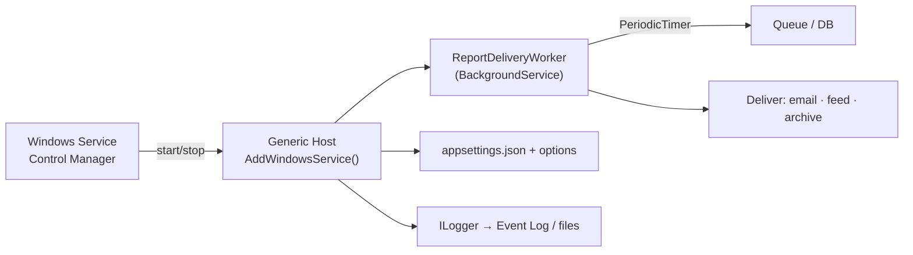

# 05 · .NET 10 Windows Service (Worker Service)

- Develop: `dotnet run` (runs as a console app).
- Install on Windows: [`install-service.ps1`](install-service.ps1) (publish, `sc.exe create`, restart-on-failure).

## Basic
- `BackgroundService.ExecuteAsync` is the long-running loop; `AddWindowsService()` integrates with the Service Control Manager.
- Configuration via `appsettings.json` + strongly typed options.

## Intermediate
- `PeriodicTimer` + `CancellationToken` for clean polling and **graceful shutdown**.
- Catch and log per-batch errors so one bad batch does not kill the service; set service **recovery actions**.

## Advanced
- Migrating from .NET Framework `ServiceBase`: move to SDK-style project + Worker Service, replace `app.config` with `appsettings.json`, re-test side by side.
- Same worker code can run in a container on Linux/AKS (only `AddWindowsService` is Windows-specific; it is a no-op elsewhere).
- WinForms/WPF also run on .NET 10 (Windows only) with DI and modern C#.
