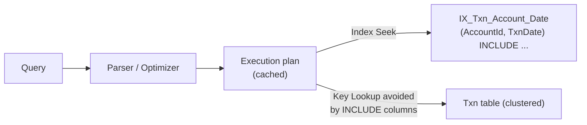

# 06 · SQL Server & DB2

- [`schema.sql`](schema.sql): tables, covering index, window functions, CTE ranking, safe transfer with `TRY/CATCH`.
- [`db2-equivalents.sql`](db2-equivalents.sql): side-by-side DB2 syntax.
- [`Program.cs`](Program.cs): parameterized ADO.NET access (provider-agnostic `DbConnection`).

## Basic
- Clustered vs non-clustered index; primary/foreign keys; JOIN types; `GROUP BY` / `HAVING`.

## Intermediate
- Window functions (`ROW_NUMBER`, running `SUM() OVER`), CTEs, **SARGable** predicates (no functions on indexed columns).
- Transactions & isolation: READ COMMITTED, SNAPSHOT (RCSI) to reduce blocking; avoid `NOLOCK`/`WITH UR` for money.

## Advanced
- Read the execution plan: seeks vs scans, key lookups, parameter sniffing (`OPTION (RECOMPILE)` / `OPTIMIZE FOR`).
- Deadlocks: consistent access order, short transactions, retry on 1205.
- DB2 → SQL Server migration: SSMA for DB2, data-type mapping (`TIMESTAMP` → `DATETIME2`, `DECFLOAT`), `FETCH FIRST` → `TOP`/`OFFSET-FETCH`, test with real volumes.
