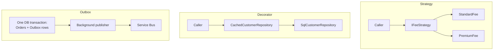

# 07 · .NET Design Patterns & SOLID

Run: `dotnet run` (each pattern prints what it does).

| Pattern | Problem it solves | In this demo |
|--------|-------------------|--------------|
| **Strategy** | Replace big if/switch blocks; Open/Closed principle | fee rules selected with .NET 8+ keyed services |
| **Decorator** | Add caching/logging/retries without editing the class | `CachedCustomerRepository` wraps the SQL repository |
| **Mediator** | Keep controllers thin; one handler per request (CQRS style) | `SimpleMediator` resolves handlers from DI (MediatR-like) |
| **Outbox** | Publish events reliably together with a DB change | order + event saved together, published once |
| **Retry / backoff** | Transient failures (timeouts, 503s) | exponential delays 50 → 100 → 200 ms |

## Basic — SOLID
Single responsibility · Open/closed · Liskov substitution · Interface segregation · Dependency inversion (depend on interfaces, inject with DI).

## Intermediate
- DI lifetimes: **Transient**, **Scoped** (per request, e.g. DbContext), **Singleton** (thread-safe!). Never inject Scoped into Singleton.
- Adapter pattern: wrap legacy/third-party APIs (e.g., WCF services) behind a clean interface.

## Advanced
- Resilience in production: `Microsoft.Extensions.Http.Resilience` (Polly) with retry + circuit breaker + timeout.
- Outbox consumers must be **idempotent** (at-least-once delivery).
