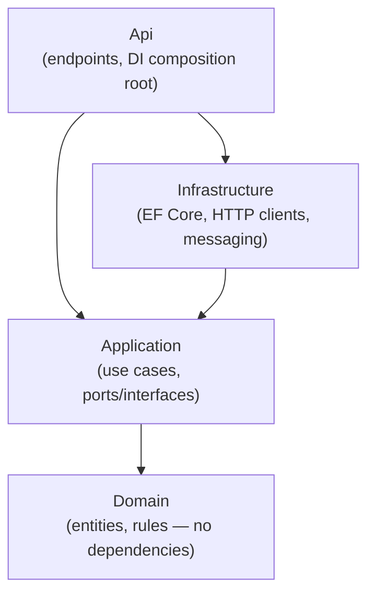
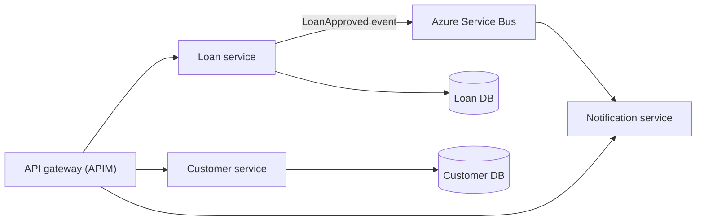

# 08 · Clean Architecture & Microservices

Run: `dotnet run`, then `POST /api/loans` with `{"customerId":"GOOD-1","amount":25000}`.

Dependencies point **inward**: Domain knows nothing about databases or HTTP, so rules are easy to test and frameworks are easy to replace.

## Basic
- Layers and the dependency rule; one database per microservice.

## Intermediate
- Sync (REST/gRPC) vs async (Service Bus events) communication; Outbox for reliable events (see `07`).
- Resilience: timeouts, retries, circuit breaker; correlation IDs and OpenTelemetry tracing across services.

## Advanced
- Saga (orchestration vs choreography) for multi-service transactions with compensations.
- Start as a **modular monolith**, split into services only where scaling or team ownership needs it.
