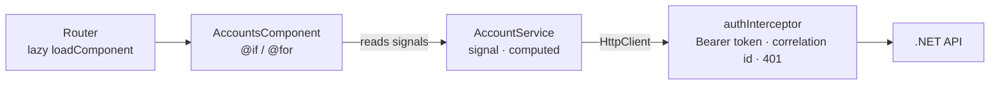

# 09 · Angular (v17+): standalone components, signals, interceptors

Files in [`src/app`](src/app). Drop them into a project created with `ng new` (standalone) and call `bootstrapApplication(AppComponent, appConfig)`.

## Basic
- Components, templates, data binding, services + dependency injection (`inject()`), routing.

## Intermediate
- **Signals** (`signal`, `computed`, `effect`) vs RxJS: signals for UI state, RxJS for streams/events.
- Functional interceptors for auth, logging and error handling; route guards (`CanActivateFn`).

## Advanced
- Change detection: OnPush, signals, zoneless (`provideExperimentalZonelessChangeDetection`).
- Performance: lazy routes, `@defer` blocks, `track` in `@for`, bundle budgets.
- Security: tokens in memory/session storage (not localStorage), MSAL for Azure AD / Entra ID, Angular's built-in XSS sanitization.
