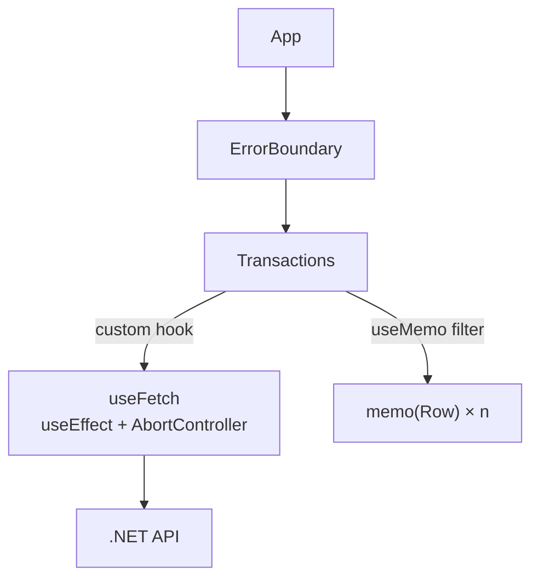

# 10 · React (18+, TypeScript): hooks, data fetching, error boundaries

Type-check: `npm install && npm run typecheck`. Files are ready to drop into a Vite React-TS app.

## Basic
- Components and props, `useState`, `useEffect`, lists with stable `key`s, controlled inputs.

## Intermediate
- Custom hooks; cancel requests with `AbortController`; avoid stale state and race conditions.
- `useMemo` / `useCallback` / `memo` only where re-renders are measurably costly.

## Advanced
- Server state with TanStack Query (caching, retries) instead of hand-rolled fetch.
- React 18 concurrency: `useTransition`, `Suspense`; React 19 actions and the `use` hook.
- Error boundaries for render errors; auth with MSAL React for Entra ID.
