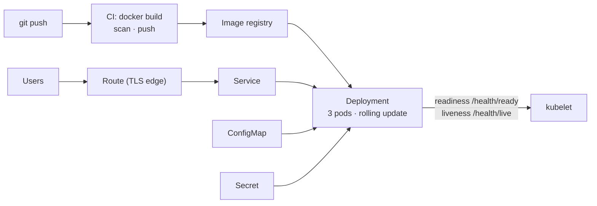

# 11 · .NET 8 in Containers on OpenShift

- [`Dockerfile`](Dockerfile): multi-stage build, non-root user, port 8080. Build from the repo root:
  `docker build -f 11-containers-openshift/Dockerfile -t orders-api .`
- [`openshift/deployment.yaml`](openshift/deployment.yaml): Deployment + Service + Route (TLS edge) + ConfigMap; `oc apply -f openshift/`.

## Basic
- Image vs container; multi-stage builds keep the SDK out of the runtime image.
- Config through environment variables (`Section__Key`), secrets via Secret objects.

## Intermediate
- **Readiness** (take out of load balancing) vs **liveness** (restart) probes, mapped to ASP.NET Core health checks (see `03`).
- Graceful shutdown: SIGTERM → `IHostApplicationLifetime.ApplicationStopping` → finish in-flight requests within `terminationGracePeriodSeconds`.
- OpenShift runs containers with a random non-root UID: don't write to the image filesystem; use volumes or `/tmp`.

## Advanced
- Requests/limits and .NET GC: container-aware memory limits, `DOTNET_gcServer`, `DOTNET_GCHeapHardLimitPercent`.
- Image hardening: chiseled/distroless images, vulnerability scanning, signed images.
- Scale with HPA; BuildConfig / Tekton pipelines vs external CI.
