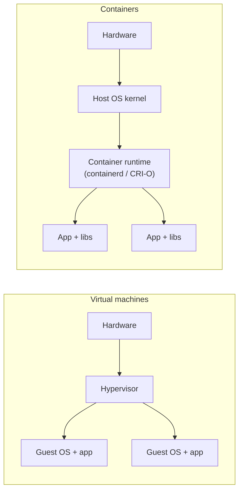
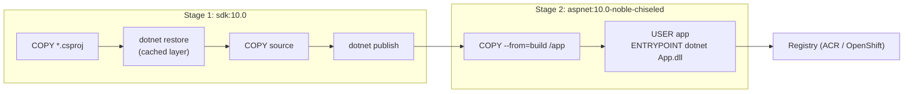
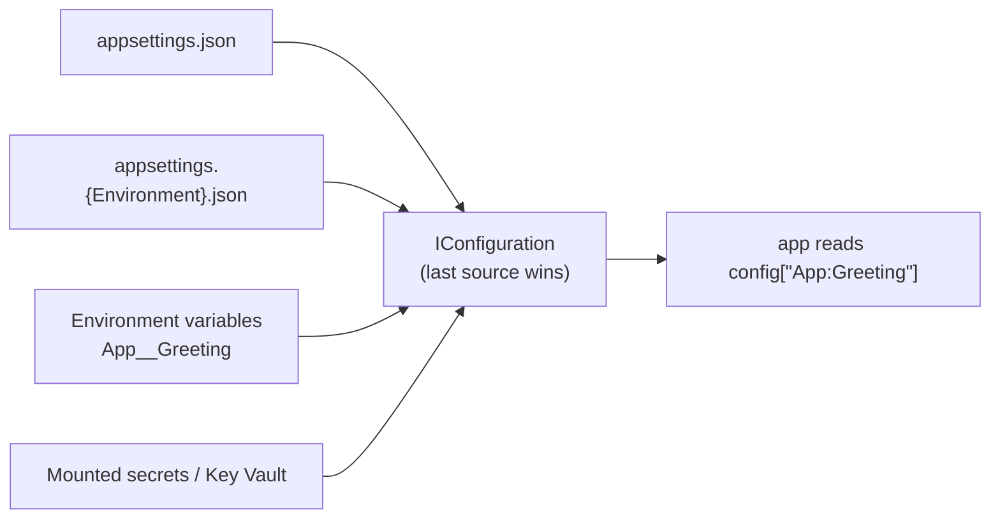
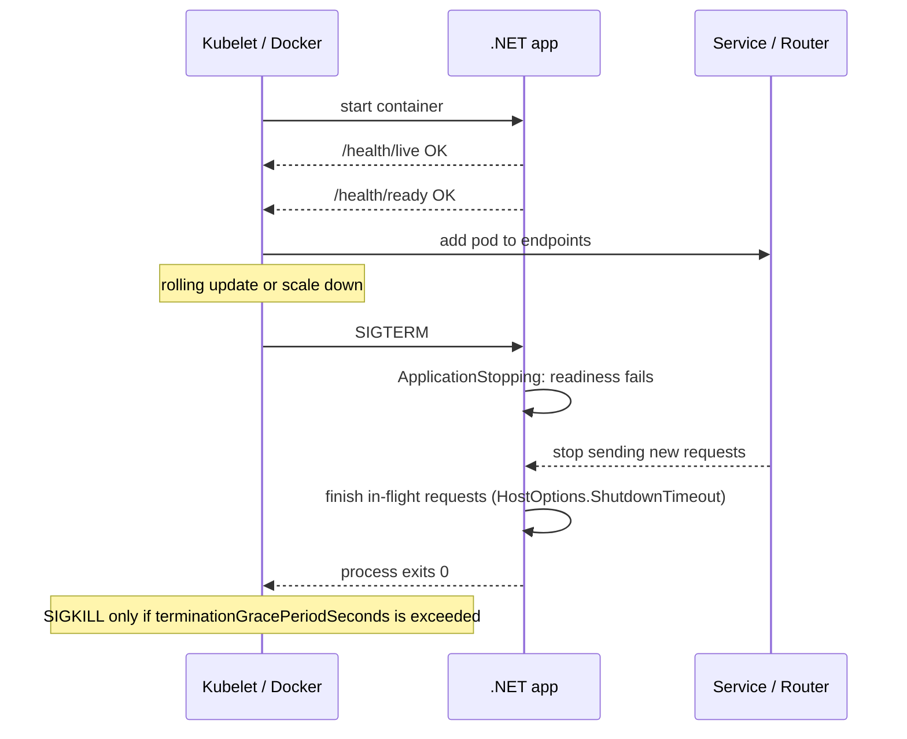
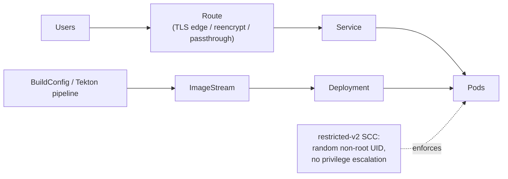

# 11 · .NET in Containers (Docker → OpenShift / AKS)

| Path | What it shows |
|------|---------------|
| [`ContainerApp/`](ContainerApp) | Runnable container-ready ASP.NET Core 8 app: env-var config, JSON logs, liveness/readiness, **graceful shutdown**, `/runtime` page showing container limits |
| [`ContainerApp/Dockerfile`](ContainerApp/Dockerfile) | Multi-stage build with a **chiseled** (distroless) runtime image, non-root |
| [`ContainerApp/docker-commands.md`](ContainerApp/docker-commands.md) | Build, run with CPU/memory limits, test shutdown, inspect layers |
| [`Dockerfile`](Dockerfile) | Containerizes the `03-rest-api` sample from the repo root |
| [`openshift/deployment.yaml`](openshift/deployment.yaml) | Deployment, Service, Route (TLS), ConfigMap, Secret, probes, security context |

Run locally without Docker: `dotnet run --project ContainerApp`, then open `/runtime` and `/health/ready`.

## 1. Basics: what a container is

- **Image** = read-only template made of layers; **container** = a running instance of an image with its own writable layer.
- Containers share the host **kernel** and are isolated with Linux **namespaces** (processes, network, filesystem) and limited with **cgroups** (CPU, memory).
- **Registry** stores images: Docker Hub, MCR (Microsoft), ACR (Azure), the OpenShift internal registry.
- Containers are **ephemeral**: anything written inside is lost on restart, so use volumes, databases or Blob Storage.

## 2. .NET images

| Image | Contains | Use for |
|-------|----------|---------|
| `mcr.microsoft.com/dotnet/sdk:10.0` | SDK, compilers, CLI | Build stage only |
| `dotnet/aspnet:10.0` | ASP.NET Core + .NET runtime | Web APIs |
| `dotnet/runtime:10.0` | .NET runtime | Console apps, workers |
| `dotnet/runtime-deps:10.0` | OS libraries only | Self-contained / Native AOT apps |
| `*-chiseled` | Ubuntu without shell or package manager, non-root | Production: smaller and fewer CVEs |
| `*-alpine` | Alpine Linux (musl) | Small images; test globalization |

Since .NET 8, images listen on **port 8080** by default (`ASPNETCORE_HTTP_PORTS`) and include a non-root user `app`.

## 3. Multi-stage build and layer caching

- Copy the `.csproj` and restore **before** copying source so NuGet restore is cached until packages change.
- Only the publish output reaches the final image: no SDK, no source code.
- Alternative with no Dockerfile: `dotnet publish -t:PublishContainer` (settings in the `.csproj`).

## 4. Configuration and secrets

- Double underscore `__` in an environment variable maps to `:` in configuration (`ConnectionStrings__Db`).
- Never bake secrets into the image. Use Kubernetes/OpenShift Secrets, the Key Vault CSI driver, or managed/workload identity (see `12`, `13`).
- Same image in every environment; only configuration changes.

## 5. Container lifecycle and graceful shutdown

- **Liveness** failure means restart the container; **readiness** failure means take it out of load balancing. Keep liveness simple: never check the database in liveness.
- **Startup probe** for slow-starting apps, so liveness does not kill them during warm-up.
- `HostOptions.ShutdownTimeout` must be shorter than `terminationGracePeriodSeconds`.

## 6. .NET is container-aware

- `Environment.ProcessorCount` and thread-pool sizing respect `--cpus` / CPU limits.
- The GC heap limit defaults to **75% of the memory limit**; tune with `DOTNET_GCHeapHardLimitPercent`.
- Server GC uses more memory; since .NET 9, **DATAS** (dynamic adaptation) is on by default with Server GC and shrinks the heap for small pods. On older versions use `DOTNET_gcServer=0` or `DOTNET_GCDynamicAdaptationMode=1`.
- Out of memory: the container is **OOMKilled** (exit code 137). Set memory requests and limits and watch the restart count.

## 7. OpenShift specifics

- Pods run with a **random UID** in group 0: the app must not need root and must not write to its image folders (use `/tmp` or volumes).
- **Route** is OpenShift's ingress; TLS termination modes: edge, re-encrypt, passthrough.
- Builds: S2I (`dotnet` builder image), BuildConfig with Dockerfile, or Tekton / OpenShift Pipelines.
- `oc` CLI: `oc new-app`, `oc apply -f`, `oc rollout status`, `oc logs -f`, `oc rsh` (not possible with chiseled images, which have no shell; use `oc debug`).

## 8. Interview questions (basic → advanced)

1. Image vs container vs registry?
2. Why multi-stage builds, and why copy the `.csproj` before the source?
3. Difference between `sdk`, `aspnet`, `runtime`, `runtime-deps` and chiseled images?
4. How does ASP.NET Core read configuration in a container? What does `App__Greeting` map to?
5. Liveness vs readiness vs startup probes; what goes wrong if liveness checks the database?
6. Walk through what happens on `SIGTERM` and how you avoid dropped requests during a rolling update.
7. How does .NET react to CPU and memory limits? What causes exit code 137?
8. Why does an app that works in Docker fail on OpenShift with "permission denied"?
9. How do you shrink the image and reduce vulnerabilities (chiseled, Native AOT, scanning, signing)?
10. Where do secrets live, and how do pods authenticate to Azure without secrets?
