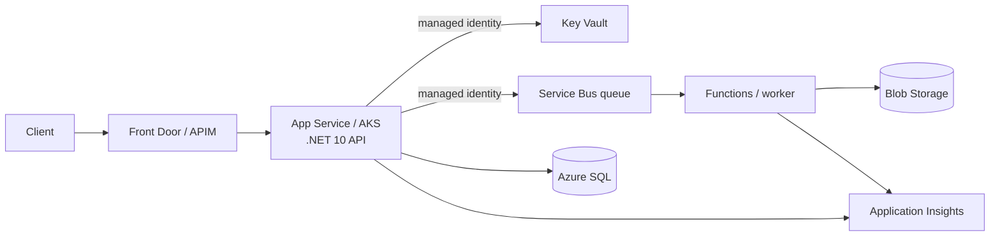

# 12 · Azure Services for .NET

- [`main.bicep`](main.bicep): App Service (Linux, .NET 10) + Key Vault + Service Bus, with **managed identity + RBAC**, so there are no connection strings or secrets in config.
  Deploy: `az deployment group create -g <rg> -f main.bicep`
- [`ManagedIdentity.cs`](ManagedIdentity.cs): `DefaultAzureCredential` with Key Vault config and Service Bus.

## Choosing compute
| Need | Service |
|------|---------|
| Web app/API, minimal ops | App Service |
| Event-driven, short tasks | Azure Functions |
| Containers without managing Kubernetes | Container Apps |
| Full Kubernetes control, many services | AKS |

## Basic
- Resource groups, regions, App Service plans, Storage, Azure SQL, Key Vault.

## Intermediate
- Managed identity + RBAC instead of secrets; `DefaultAzureCredential` chain.
- Messaging: Service Bus (commands, ordering, sessions, dead-letter) vs Event Grid (events) vs Event Hubs (streaming).

## Advanced
- Infrastructure as Code with Bicep; private endpoints + VNet integration; zone redundancy.
- Observability with Application Insights / OpenTelemetry; cost control with autoscale and reservations.
