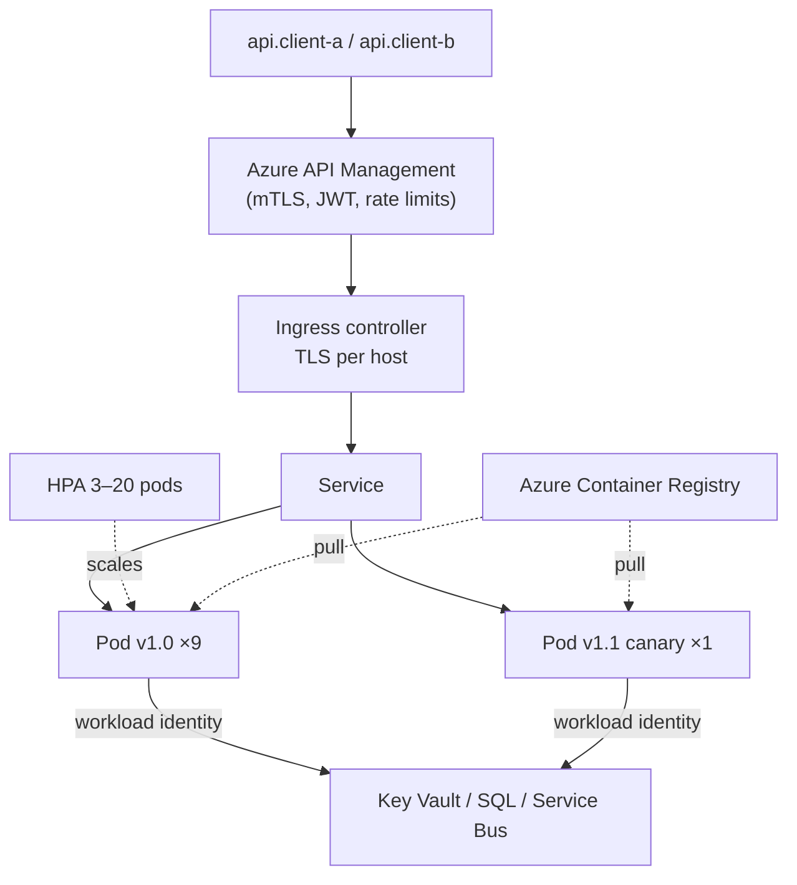

# 13 · Azure Kubernetes Service (AKS)

- [`workload-identity.yaml`](workload-identity.yaml): ServiceAccount + Deployment using **Entra workload identity**.
- [`hpa-ingress.yaml`](hpa-ingress.yaml): autoscaling, PodDisruptionBudget, and TLS ingress for **multiple client domains** on one cluster.
- [`canary.yaml`](canary.yaml): replica-based canary release.

## Basic
- Control plane (managed by Azure) vs node pools; Pods, Deployments, Services, Ingress; `kubectl apply`.

## Intermediate
- Autoscaling: HPA (pods), cluster autoscaler (nodes), KEDA (event-driven, e.g. Service Bus queue length).
- Identity: workload identity for pods, ACR pull via kubelet identity; Key Vault CSI driver for secrets.
- Rollouts: rolling update, PodDisruptionBudget, readiness probes.

## Advanced
- Network: Azure CNI Overlay, network policies, private cluster, APIM in front with mTLS to the ingress.
- Releases: blue-green / canary with Argo Rollouts, Flagger or Istio traffic splitting (see `15`).
- Operations: upgrades with surge nodes, Azure Monitor / Managed Prometheus + Grafana, cost by namespace.
