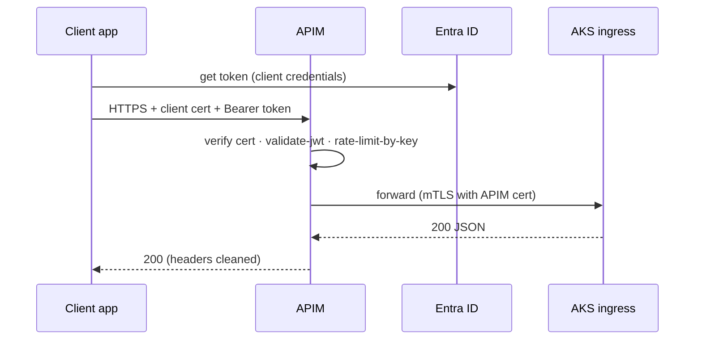

# 14 · Azure API Management (APIM)

- [`policies.xml`](policies.xml): JWT validation, per-client rate limiting, **mTLS client certificates**, correlation ids, AKS backend with APIM's own client cert, ProblemDetails errors.
- [`ai-gateway-policy.xml`](ai-gateway-policy.xml): APIM as an **AI gateway** for Azure OpenAI (managed identity, token-per-minute limits, token metrics, backend pool).

## Basic
- Gateway, developer portal, management plane; products, subscriptions, APIs, operations.
- Policy scopes: global → product → API → operation (`<base />` decides inheritance order).

## Intermediate
- Security: `validate-jwt`, client certificates, IP filtering, named values backed by Key Vault.
- Traffic: `rate-limit-by-key`, `quota-by-key`, caching, backend pools and circuit breakers.
- Versioning (path/header/query) and revisions for safe changes.

## Advanced
- Internal VNet mode / private endpoints in front of AKS; self-hosted gateway for on-prem.
- AI gateway: token limits, semantic caching, load balancing across Azure OpenAI deployments.
- APIOps: policies and API definitions in Git, deployed by pipeline.
