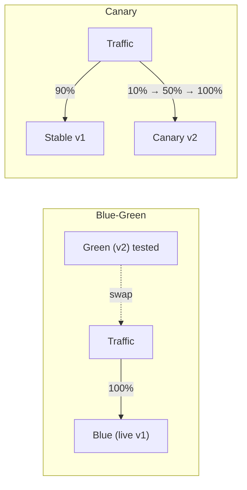

# 15 · Azure DevOps CI/CD: Blue-Green vs Canary

- [`azure-pipelines.yml`](azure-pipelines.yml): build → test → Docker push → **canary** on AKS (10% → 50% → promote, auto-reject on failure).
- [`blue-green-appservice.yml`](blue-green-appservice.yml): **blue-green** with App Service deployment slots and slot swap.

| | Blue-Green | Canary |
|---|---|---|
| Traffic shift | All at once (swap) | Gradual percentages |
| Rollback | Instant swap back | Stop / reject canary |
| Cost | Two full environments | Few extra pods |
| Best for | Big releases, DB-compatible changes, fast rollback | Risky changes, validate with real traffic & metrics |

## Basic
- Pipelines as YAML, stages/jobs/steps, service connections, artifacts, variable groups.

## Intermediate
- Environments with approvals and checks; deployment strategies (`runOnce`, `rolling`, `canary`).
- Quality gates: unit tests, code coverage, SonarQube/SAST, container scanning.

## Advanced
- Database changes must be backward-compatible across both versions (expand → migrate → contract).
- Automated promotion based on App Insights metrics (error rate, p95 latency).
- Templates (`extends`) for standard, secure pipelines across teams; workload identity federation for service connections.
