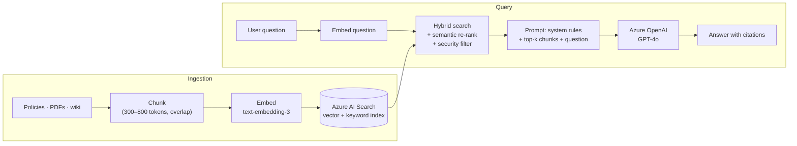

# 16 · Azure OpenAI + Azure AI Search: Retrieval-Augmented Generation (RAG)

- `dotnet run`: the full RAG flow **offline**, with local stand-ins for embeddings, the vector index and the LLM.
- [`azure/AzureAdapters.cs`](azure/AzureAdapters.cs): the production version with **Azure OpenAI** (embeddings + chat) and **Azure AI Search** (hybrid + semantic ranking, security filter), using managed identity.



Sample output:
```
Q: Who must approve a large international wire?
A: Outgoing international wires above $10,000 require a second approver. [wire-policy.md]
```

## Basic
- Why RAG: LLMs don't know your private, current data; retrieval grounds answers and enables citations.
- Embeddings and cosine similarity; chunking.

## Intermediate
- **Hybrid search** (BM25 + vectors) with **semantic ranker** beats either alone.
- Prompt design: strict system message, "say you don't know", temperature 0, cite sources.
- Security trimming: filter by groups so users only retrieve documents they may see.

## Advanced
- Evaluation: groundedness, relevance and retrieval recall with a test set (Azure AI Foundry evaluations).
- Cost/latency: smaller embedding models, caching, APIM AI gateway token limits (see `14`).
- Safety: Azure AI Content Safety, prompt-injection shields, PII redaction, audit logging.
