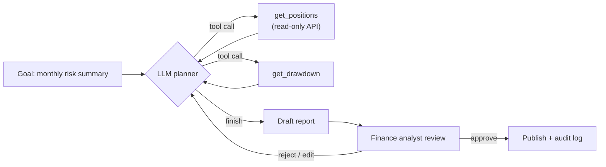

# 17 · AI Agents (Azure OpenAI / Azure AI Agent Service)

`dotnet run`: an agent that **plans → calls read-only tools → drafts a report → waits for human approval**, with an audit trail. Its planner is scripted so it runs offline; [`azure/ToolCallingAgent.cs`](azure/ToolCallingAgent.cs) is the same loop with real Azure OpenAI function calling.

## Adding an agent to an existing production banking app safely
- **Read-only tools** over existing APIs; no direct database writes.
- **Human in the loop**: reports are drafts until an analyst approves.
- **Guardrails**: tool allow-list, max steps, temperature 0, "use tools for every number".
- **Audit**: every tool call, draft and approval is logged.
- **Identity**: the agent runs with its own managed identity and least-privilege RBAC.

## Basic
- Agent = LLM + tools + loop + memory. Function/tool calling: the model returns a tool name + JSON args; your code runs it.

## Intermediate
- Planning patterns: ReAct, plan-and-execute; multi-agent hand-offs (Semantic Kernel / Microsoft Agent Framework, Azure AI Foundry Agent Service).
- State and memory: conversation threads, summarisation, RAG as a tool (see `16`).

## Advanced
- Evaluation: task success rate, tool-call accuracy, groundedness; red-team for prompt injection through tool outputs.
- Operations: tracing with OpenTelemetry, token budgets via APIM, fallbacks when the model or tools fail.
- MCP (Model Context Protocol) to expose existing services as tools in a standard way.
