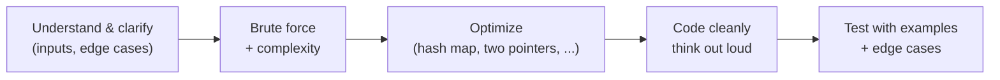

# 18 · C# Coding Interview — 22 problems, Basic → Advanced

Run all solutions with self-checks: `dotnet run`

Several problems are taken from real candidate reports of .NET live-coding rounds (Two Sum, Move Zeros, Singleton, LINQ filters, async timing, merge step, List implementation); the advanced ones reflect 2026 senior-level scenario questions (idempotent payments, rate limiting, message backlogs, cache stampede).

| # | Problem | Level | Complexity |
|---|---------|-------|------------|
| 1 | [Reverse a string without using Reverse()](Problems/P01_ReverseAStringWithoutUsing.cs) | Basic | Time O(n), space O(n) for the new string (strings are immutable). |
| 2 | [Check if a string is a palindrome](Problems/P02_CheckIfAStringIs.cs) | Basic | Time O(n), space O(1). |
| 3 | [First non-repeating character & character counts](Problems/P03_FirstNonRepeatingCharacterCharacter.cs) | Basic | Time O(n), space O(k) where k = distinct characters. |
| 4 | [Are two strings anagrams?](Problems/P04_AreTwoStringsAnagrams.cs) | Basic | Time O(n), space O(k). |
| 5 | [LINQ: filter 5-letter words starting with "s" and sort them](Problems/P05_LINQFilter5LetterWords.cs) | Basic | Time O(n log n) for the sort. |
| 6 | [Two Sum](Problems/P06_TwoSum.cs) | Basic | Time O(n), space O(n). |
| 7 | [Move all zeros to the front (keep order of others)](Problems/P07_MoveAllZerosToThe.cs) | Basic | Time O(n), space O(1). |
| 8 | [LINQ on a student/employee list (group, aggregate, top N)](Problems/P08_LINQOnAStudentEmployee.cs) | Intermediate | Grouping O(n); top 3 with sorting O(n log n). |
| 9 | [Thread-safe Singleton](Problems/P09_ThreadSafeSingleton.cs) | Intermediate | O(1). |
| 10 | [Merge two sorted arrays (last step of merge sort)](Problems/P10_MergeTwoSortedArraysLast.cs) | Intermediate | Merge: O(n + m). Merge sort: O(n log n) time, O(n) extra space, stable. |
| 11 | [Async puzzle: how long does this code take?](Problems/P11_AsyncPuzzleHowLongDoes.cs) | Intermediate | Sequential ≈ sum of waits; WhenAll ≈ the longest wait. |
| 12 | [Implement a simple generic List<T> (dynamic array)](Problems/P12_ImplementASimpleGenericList.cs) | Intermediate | Add amortized O(1); indexer O(1); RemoveAt O(n). |
| 13 | [Banking: transfer money between accounts (validation + thread safety)](Problems/P13_BankingTransferMoneyBetweenAccounts.cs) | Intermediate | Transfer O(1); search O(n) in memory (in a real system: indexed DB query). |
| 14 | [Call many APIs in parallel with a concurrency limit](Problems/P14_CallManyAPIsInParallel.cs) | Intermediate | Total time ≈ (n / 5) × call time. |
| 15 | [Retry with exponential backoff](Problems/P15_RetryWithExponentialBackoff.cs) | Intermediate | Worst case waits ≈ base × (2^(n−1) − 1) plus jitter. |
| 16 | [Fix the N+1 query problem (EF Core)](Problems/P16_FixTheN1Query.cs) | Intermediate | From 1 + N round trips to 1. |
| 17 | [LRU cache](Problems/P17_LRUCache.cs) | Advanced | Get and Put O(1); space O(capacity). |
| 18 | [Idempotent payment endpoint](Problems/P18_IdempotentPaymentEndpoint.cs) | Advanced | O(1) per request. |
| 19 | [Rate limiter (fixed window per client)](Problems/P19_RateLimiterFixedWindowPer.cs) | Advanced | O(1) per request. |
| 20 | [Producer/consumer with Channel<T> (process a big message backlog)](Problems/P20_ProducerConsumerWithChannelT.cs) | Advanced | Throughput scales with consumers until the downstream limit. |
| 21 | [Cache stampede: 200 requests hit one expired key](Problems/P21_CacheStampede200RequestsHit.cs) | Advanced | One database call per expiry instead of one per request. |
| 22 | [Code review: find the bugs](Problems/P22_CodeReviewFindTheBugs.cs) | Advanced | n/a |

## Live-coding tips
- Restate the problem and ask about input size, nulls, duplicates and case sensitivity.
- Say the simple solution first, then improve it, and state time/space complexity.
- Think out loud; handle edge cases; walk through one example at the end.
- For concurrency questions, explain *why* the code is thread-safe (locks, `Interlocked`, `ConcurrentDictionary`, lock ordering).
