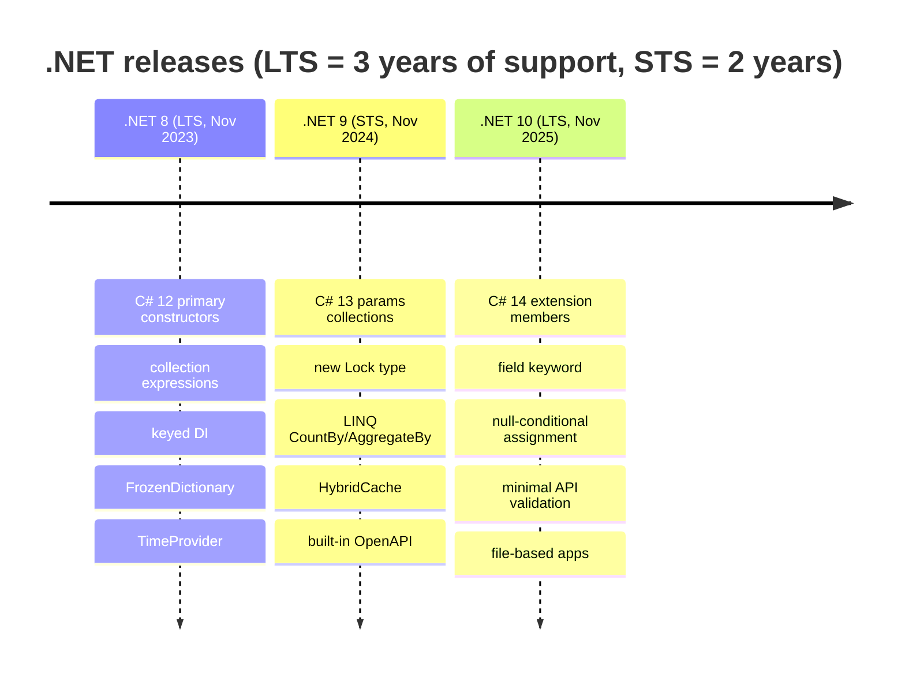

# 19 · What's new: C# 12 → 14, .NET 8 → 10

- `dotnet run`: C# 12 / .NET 8 features (runs on .NET 8).
- [`net10/WhatsNew.cs`](net10/WhatsNew.cs): C# 13/14 and .NET 9/10 features. Needs the .NET 10 SDK.

| Feature | Version | Why it matters |
|--------|---------|----------------|
| Primary constructors | C# 12 | Less DI boilerplate in services |
| Collection expressions `[..a, 4]` | C# 12 | One syntax for arrays, lists, spans |
| Keyed services | .NET 8 | Several implementations of one interface (see `07`) |
| `TimeProvider` | .NET 8 | Testable time-dependent logic |
| `params ReadOnlySpan<T>` | C# 13 | No array allocation for params |
| `System.Threading.Lock` | .NET 9 | Faster, clearer locking |
| `CountBy`, `AggregateBy`, `Index` | .NET 9 | Common LINQ grouping in one call |
| `HybridCache` | .NET 9 | Two-level cache + stampede protection |
| `Guid.CreateVersion7()` | .NET 9 | Time-ordered keys, fewer index page splits |
| Extension members, `field`, `?.=` | C# 14 | Extension properties, simpler properties |
| Minimal API validation, SSE | .NET 10 | Less custom validation code, streaming |

## Upgrade checklist (.NET 6/8 → 10)
1. Update `TargetFramework`, SDK in `global.json`, and NuGet packages; run the .NET Upgrade Assistant or GitHub Copilot app modernization.
2. Read the breaking-changes list for each version; fix analyzer warnings.
3. Update container base images (`aspnet:10.0`) and pipeline SDK versions.
4. Run the full test suite and performance tests; deploy with canary (see `15`).
