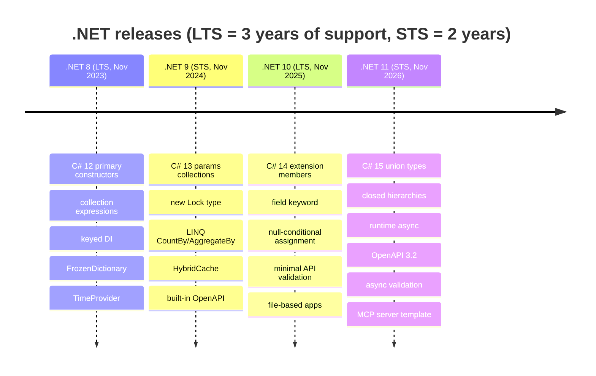

# 19 · What's new: C# 12 → 15, .NET 8 → 11

- `dotnet run`: C# 12 features; [`net10/WhatsNew.cs`](net10/WhatsNew.cs) (C# 13/14, .NET 9/10) is compiled in the same project on .NET 10.
- [`net11/CSharp15.cs`](net11/CSharp15.cs): **C# 15 / .NET 11** (union types, closed hierarchies, collection arguments, extension indexers, labeled break/continue) plus ASP.NET Core 11 notes. Needs the .NET 11 SDK; not compiled here.

> **Support status (Nov 2026):** .NET 11 shipped on Nov 10, 2026 (STS, supported until Nov 2028). **.NET 10 is the current LTS.** .NET 8 and .NET 9 reached **end of support on Nov 10, 2026**, so production apps should move to .NET 10 (or 11). This repo targets .NET 10.

| Feature | Version | Why it matters |
|--------|---------|----------------|
| Primary constructors | C# 12 | Less DI boilerplate in services |
| Collection expressions `[..a, 4]` | C# 12 | One syntax for arrays, lists, spans |
| Keyed services | .NET 8 | Several implementations of one interface (see `07`) |
| `TimeProvider` | .NET 8 | Testable time-dependent logic |
| `params ReadOnlySpan<T>` | C# 13 | No array allocation for params |
| `System.Threading.Lock` | .NET 9 | Faster, clearer locking |
| `CountBy`, `AggregateBy`, `Index` | .NET 9 | Common LINQ grouping in one call |
| `HybridCache` | .NET 9 | Two-level cache + stampede protection |
| `Guid.CreateVersion7()` | .NET 9 | Time-ordered keys, fewer index page splits |
| Extension members, `field`, `?.=` | C# 14 | Extension properties, simpler properties |
| Minimal API validation, SSE | .NET 10 | Less custom validation code, streaming |
| **Union types** `union Pet(Cat, Dog)` | C# 15 | Model "one of these" results with exhaustive `switch`; no base class or OneOf library |
| **Closed hierarchies** `closed record` | C# 15 | Compiler knows every subtype, so switches need no default arm |
| Collection arguments `[with(capacity: n), ..x]` | C# 15 | Capacity/comparer inside collection expressions |
| Extension indexers, labeled `break`/`continue` | C# 15 | Indexers on any type; exit nested loops cleanly |
| Runtime async, Zstandard, Native AOT CLI host | .NET 11 | Faster async, better compression, quicker tooling |
| Async validation, OpenAPI 3.2, CSRF protection | ASP.NET Core 11 | Database-backed validation; check OpenAPI client generators |
| SignalR auth refresh, Blazor AI components (AG-UI) | ASP.NET Core 11 | Long-lived connections and agentic UIs |
| MCP server template, build-time vulnerability/EOL checks | .NET 11 SDK | Build AI tool servers; catch risky packages early |

## Interview angle
- "Which version would you pick for a new banking service today?" → **.NET 10 (LTS)** for a 3-year support window; adopt .NET 11 for teams that upgrade yearly.
- "What problem do union types solve?" → returning one of several outcomes (approved / rejected / needs review) with compiler-checked handling, instead of exceptions, nulls or a base class.

## Upgrade checklist (.NET 6/8 → 10)
1. Update `TargetFramework`, SDK in `global.json`, and NuGet packages; run the .NET Upgrade Assistant or GitHub Copilot app modernization.
2. Read the breaking-changes list for each version; fix analyzer warnings.
3. Update container base images (`aspnet:10.0`) and pipeline SDK versions.
4. Run the full test suite and performance tests; deploy with canary (see `15`).
