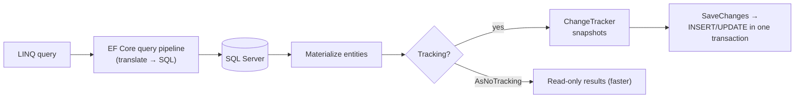

# 20 · Entity Framework Core 8

[`BankingDbContext.cs`](BankingDbContext.cs): entity configuration, money precision, optimistic concurrency (`RowVersion`), soft-delete filters, no-tracking projections, avoiding N+1, compiled queries, `ExecuteUpdate`, retry on transient faults, and migrations.
Reference code: rename `EfCore.csproj.txt` to `EfCore.csproj` to restore the EF Core packages and build.

## Basic
- `DbContext` = unit of work + repository; `DbSet<T>` per aggregate; migrations to evolve the schema.
- Relationships, keys and indexes via Fluent API (`IEntityTypeConfiguration<T>`).

## Intermediate
- `AsNoTracking` + projections for reads; `Include` / split queries to avoid **N+1**.
- **Optimistic concurrency** with `rowversion` and `DbUpdateConcurrencyException`.
- DbContext lifetime is **scoped** (one per request); `AddDbContextPool` for throughput.

## Advanced
- Compiled queries, `ExecuteUpdate`/`ExecuteDelete`, raw SQL with `FromSql` (parameterized), interceptors for auditing.
- Connection resiliency (`EnableRetryOnFailure`) with Azure SQL; idempotent migration scripts deployed by the pipeline.
- When to use Dapper or stored procedures instead (reporting, bulk work; see `06`).
