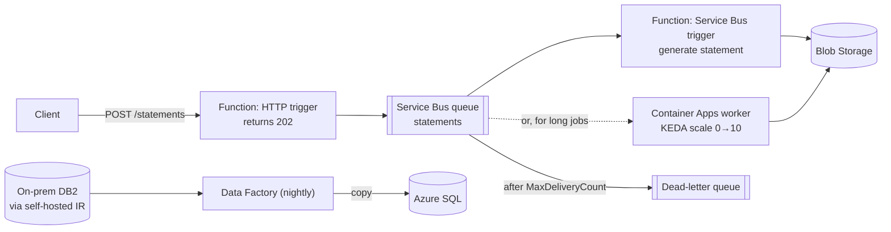

# 21 · Azure Functions, Service Bus, Container Apps & Data Factory

| Path | What it shows |
|------|---------------|
| [`FunctionsApp/`](FunctionsApp) | Azure Functions **isolated worker** (.NET 8): HTTP → Service Bus output, Service Bus trigger with dead-lettering, Timer trigger. Rename `FunctionsApp.csproj.txt` to `.csproj` to build. |
| [`container-apps/main.bicep`](container-apps/main.bicep) | **Azure Container Apps** worker that scales **0 → 10** on queue length (KEDA) with managed identity |
| [`data-factory/pl_copy_transactions.json`](data-factory/pl_copy_transactions.json) | **Data Factory** pipeline: DB2 → Azure SQL staging copy, stored procedure load, failure alert |

## Basic
- Functions: triggers (HTTP, Timer, Service Bus, Blob, Event Grid) and bindings; **isolated worker** model is the supported model for .NET 8+.
- Hosting: Consumption / **Flex Consumption** (scale to zero), Premium (no cold start, VNet), Dedicated.
- Service Bus: queues (one consumer) vs topics/subscriptions (fan-out), peek-lock, dead-letter queue.

## Intermediate
- Keep HTTP functions short: queue work and return 202. Consumers must be **idempotent** (at-least-once delivery); use `MessageId` duplicate detection.
- Sessions for ordered processing per customer; scheduled messages; `maxConcurrentCalls` tuning.
- Container Apps vs Functions vs AKS: Container Apps for containerized APIs/workers with KEDA scaling and no cluster to manage.

## Advanced
- Durable Functions for long-running workflows (fan-out/fan-in, human approval, sagas).
- Data Factory: linked services, datasets, self-hosted integration runtime for on-prem DB2, incremental loads with watermarks, CI/CD with ARM templates from the Git-integrated factory.
- Managed identity everywhere (Functions → Service Bus, ACA → ACR), no connection strings.
