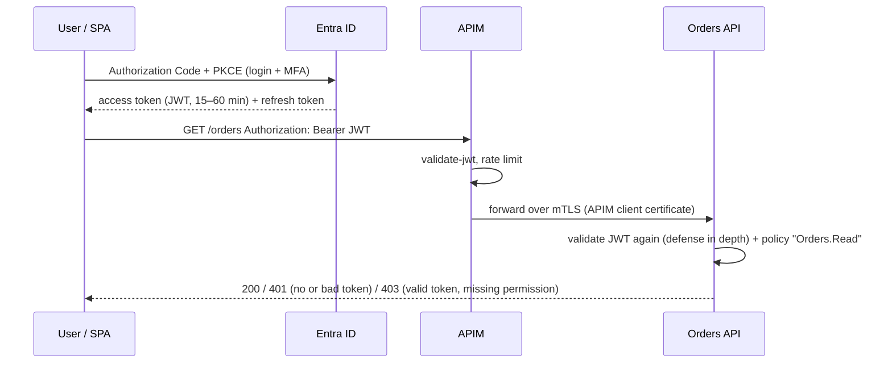

# 22 · REST API Security: OAuth 2.0, JWT, policies, mTLS

- `dotnet run`: a runnable demo of **how JWT bearer auth works**: signature, issuer, audience and expiry checks, then **policy-based authorization** (scopes, roles, MFA claim). See [`requests.http`](requests.http).
- [`production/EntraIdAndMtls.cs`](production/EntraIdAndMtls.cs): the production setup with **Microsoft Entra ID** (`AddJwtBearer`) and **mTLS** client-certificate authentication.

## Basic
- **Authentication** (who you are) vs **authorization** (what you may do); 401 vs 403.
- JWT = `header.payload.signature` (Base64URL). Signed, **not encrypted**: never put secrets or PII in it.
- OAuth 2.0 flows: **Authorization Code + PKCE** (users, SPAs, mobile), **Client Credentials** (service to service). Implicit and password flows are deprecated.

## Intermediate
- Validate issuer, audience, lifetime and signature (keys from the OIDC metadata / JWKS, rotated automatically).
- **Scopes** (`scp`) for delegated user permissions; **app roles** (`roles`) for apps and RBAC.
- Policy-based authorization; resource-based checks (can *this* user see *this* account?) to prevent **IDOR/BOLA**.

## Advanced
- **mTLS**: both sides present certificates; used between APIM and backends, or partner banks. Pin by thumbprint or issuing CA, check revocation, automate rotation from Key Vault.
- Token handling in SPAs: Backend-for-Frontend (BFF) pattern keeps tokens out of the browser.
- OWASP API Top 10: broken object-level authorization, excessive data exposure, mass assignment, rate limiting (see `03`, `14`), security headers, input validation.
