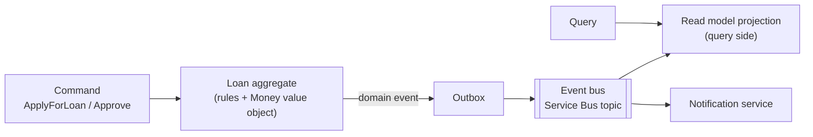
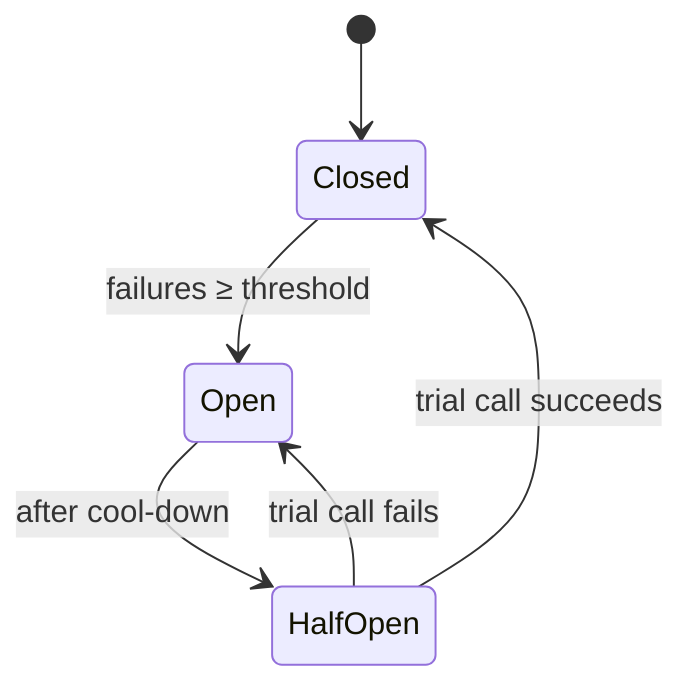

# 23 · DDD, CQRS, Event-Driven, Saga & Resilience

`dotnet run`: every pattern runs in memory and prints what happens.



```mermaid
sequenceDiagram
    participant S as Transfer saga
    participant L as Ledger
    participant P as Payment network
    S->>L: 1. reserve funds
    S->>P: 2. send payment
    P--xS: rejected
    S->>L: compensate: release reservation
    Note over S: no distributed transaction; each step has an undo
```



## Basic
- **DDD**: bounded contexts, ubiquitous language, **entities** (identity) vs **value objects** (immutable, compared by value, e.g. `Money`), **aggregates** protect invariants.
- **Event-driven**: services publish facts (`LoanApproved`); subscribers react independently.

## Intermediate
- **CQRS**: separate write model (aggregates) from read models (denormalized views); MediatR-style handlers (see `07`).
- Reliable publishing with the **Outbox**; idempotent consumers; eventual consistency in the UI.
- **Saga**: orchestration (central coordinator, this demo) vs choreography (services react to events).

## Advanced
- Resilience pipeline: timeout → retry with jitter → **circuit breaker** → fallback. In production use `Microsoft.Extensions.Http.Resilience` (`AddStandardResilienceHandler()`).
- Event sourcing (store events as the source of truth) and when it is worth the complexity.
- Durable Functions or a workflow engine for long-running sagas with timeouts and human approval.
