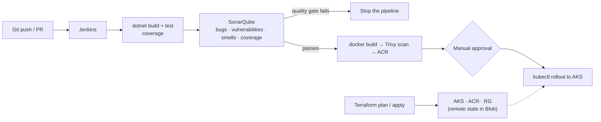

# 24 · Jenkins, Terraform & SonarQube

| Path | What it shows |
|------|---------------|
| [`Jenkinsfile`](Jenkinsfile) | Declarative pipeline: build, test + coverage, **SonarQube** analysis and quality gate, Trivy image scan, push to ACR, manual approval, AKS rollout |
| [`terraform/`](terraform) | **Terraform** for resource group, ACR and AKS (workload identity, autoscaling, zones, Azure CNI Overlay), AcrPull role, remote state |
| [`sonar-project.properties`](sonar-project.properties) | Sonar settings and quality-gate thresholds |

## Basic
- **Jenkins**: declarative pipeline, stages/steps, agents, credentials store, `post` actions.
- **Terraform**: providers, resources, variables/outputs, `init → plan → apply`, state file.
- **SonarQube**: static analysis (bugs, vulnerabilities, code smells, duplication) + coverage; quality gate on new code.

## Intermediate
- Terraform remote state with locking (Azure Storage), modules, workspaces or separate state per environment, `terraform plan` on PRs.
- Jenkins shared libraries for common steps; `withCredentials` (never echo secrets); parallel stages.
- Coverage from `coverlet` (OpenCover format) into Sonar; PR decoration.

## Advanced
- Drift detection (`terraform plan` on a schedule), policy as code (Azure Policy, OPA/Conftest, Checkov).
- Supply chain: SBOM, image signing, dependency scanning (Dependabot/Snyk/Mend).
- Jenkins vs Azure DevOps vs GitHub Actions: migration path and keeping pipelines as code (see `15`).
