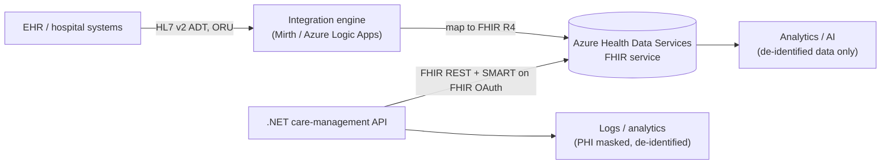

# 25 · Healthcare Domain: FHIR, HL7 & HIPAA

`dotnet run`: parse FHIR R4 `Patient` and `Observation` (LOINC-coded lab), validate, **mask PHI** for logs, and map an **HL7 v2 ADT^A01** message to FHIR.

## Basic
- **HL7 v2**: pipe-delimited messages (ADT = admit/discharge/transfer, ORU = results, ORM = orders); segments MSH, PID, PV1, OBX.
- **FHIR R4**: REST + JSON resources (`Patient`, `Encounter`, `Observation`, `MedicationRequest`, `Claim`); search (`GET /Patient?identifier=...`), bundles.
- Code systems: **LOINC** (labs), **SNOMED CT** (clinical terms), **ICD-10** (diagnoses), **CPT** (procedures).

## Intermediate
- **HIPAA**: PHI (18 identifiers), minimum necessary, audit logging of every PHI access, encryption at rest and in transit, BAAs with cloud vendors.
- **SMART on FHIR**: OAuth 2.0 scopes like `patient/Observation.read`.
- Claims (X12 837/835) and eligibility (270/271) in payer integrations.

## Advanced
- Azure Health Data Services (FHIR service, DICOM), $export for bulk data, de-identification before analytics/AI.
- Idempotent, ordered message processing (MRN as session key in Service Bus), replay and reconciliation.
- Consent management and break-the-glass access with full audit.
