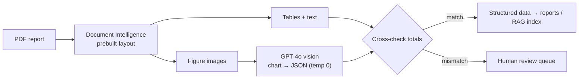
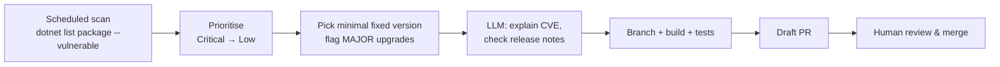

# 26 · GenAI PoCs: PDF chart/data extraction, vulnerability remediation, GitHub Copilot

| Path | What it shows |
|------|---------------|
| [`PdfExtraction/PdfReportExtractor.cs`](PdfExtraction/PdfReportExtractor.cs) | **Azure AI Document Intelligence** (tables/text) + **GPT-4o vision** (chart → JSON) with a cross-check against table totals. Reference code (Azure SDK packages). |
| [`VulnRemediation/`](VulnRemediation) | Runnable: parse `dotnet list package --vulnerable` output, prioritise by severity, pick the minimal safe upgrade, flag major-version risk, draft a PR for human review |
| [`copilot-guide.md`](copilot-guide.md) | How GitHub Copilot fits into .NET work: tests, legacy explanation, upgrades, agent mode, guardrails |

## Key points
- Use AI where it removes toil, keep **deterministic checks** (cross-totals, build, tests, re-scan) around it, and a **human approval** step for anything that reaches production or clients.
- Temperature 0 and JSON response format for extraction; validate the JSON against a schema.
- Log prompts/outputs (without sensitive data) for audit; evaluate accuracy on a labelled sample set before rollout.
