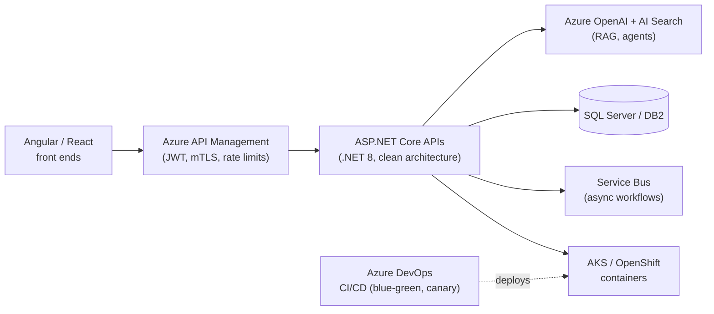

# .NET · Azure · GenAI Playbook

Hands-on, runnable examples of the technologies I use as a **Senior Software Engineer (.NET full stack)**, from C# fundamentals to Azure Kubernetes Service, API Management and AI agents. Each folder pairs **working code** with a **diagram** and a short explanation that goes from basic to advanced.

> Built with .NET 8 (LTS), C# 12, ASP.NET Core minimal APIs, Angular 17+, React 18, Azure and Azure OpenAI.



## Contents

| # | Topic | What you will find |
|---|-------|--------------------|
| 00 | [Banking domain](00-banking-domain) | Onboarding / AML-KYC flow, idempotent party creation in C# |
| 01 | [.NET fundamentals](01-dotnet-fundamentals) | CLR, GC generations, value vs reference types, IDisposable (runnable demo) |
| 02 | [C# language](02-csharp-language) | Records, pattern matching, LINQ, async/await, Span&lt;T&gt; (runnable demo) |
| 03 | [REST API](03-rest-api) | ASP.NET Core minimal API: validation, ProblemDetails, rate limiting, output caching, health checks |
| 04 | [WCF modernization](04-wcf-modernization) | WCF contract, and the same service as a modern REST API; migration path |
| 05 | [Windows service](05-windows-service) | .NET 8 Worker Service running as a Windows service |
| 06 | [SQL Server & DB2](06-sql-server-db2) | Indexing, window functions, SQL Server → DB2 migration cheat sheet |
| 07 | [Design patterns](07-design-patterns) | Strategy, Decorator, Mediator, Outbox, Retry (runnable demo) |
| 08 | [Clean architecture](08-clean-architecture) | Domain / Application / Infrastructure / API layers |
| 09 | [Angular](09-angular) | Standalone components, signals, interceptors, OnPush |
| 10 | [React](10-react) | Hooks, data fetching with cancellation, error boundaries |
| 11 | [Containers & OpenShift](11-containers-openshift) | Container basics, .NET images (chiseled), multi-stage builds, config, probes, graceful shutdown, container-aware GC, OpenShift (runnable app) |
| 12 | [Azure services](12-azure-services) | Choosing compute & messaging, managed identity, Key Vault, Bicep |
| 13 | [AKS](13-aks) | Deployment, HPA, ingress, workload identity, canary release |
| 14 | [API Management](14-api-management) | JWT validation, rate limiting, mTLS client certificates, AI gateway policies |
| 15 | [Azure DevOps](15-azure-devops) | YAML pipelines, blue-green vs canary deployments |
| 16 | [Azure OpenAI & RAG](16-azure-openai-rag) | Chat, embeddings, retrieval-augmented generation with Azure AI Search |
| 17 | [AI agents](17-ai-agents) | Agent loop with tool calling; human-in-the-loop design for banking |
| 18 | [C# coding interview](18-csharp-coding-interview) | 22 problems (basic → advanced) with tested solutions |

## Run the .NET samples

```bash
# .NET 8 SDK required
dotnet run --project 00-banking-domain
dotnet run --project 01-dotnet-fundamentals
dotnet run --project 02-csharp-language
dotnet run --project 03-rest-api            # then call the endpoints listed in 03-rest-api/README.md
dotnet run --project 07-design-patterns
dotnet run --project 11-containers-openshift/ContainerApp   # then /runtime and /health/ready
dotnet run --project 08-clean-architecture      # POST /api/loans
dotnet run --project 16-azure-openai-rag        # offline RAG flow; azure/ has the Azure OpenAI + AI Search version
dotnet run --project 17-ai-agents               # agent loop with human approval
dotnet run --project 18-csharp-coding-interview   # runs all solutions with self-checks
```

## About me

Senior Software Engineer with 15+ years in .NET full stack development for banking/wealth management and healthcare: high-volume reporting platforms, onboarding and AML/KYC platforms, cloud migrations to Azure, and GenAI/agent proofs of concept.

[LinkedIn](https://www.linkedin.com/in/babu-krishnan) · AZ-400 · AZ-104 · AZ-900 · Certified Scrum Developer

> All examples are generic and written for learning; they contain no client or employer code or data.
